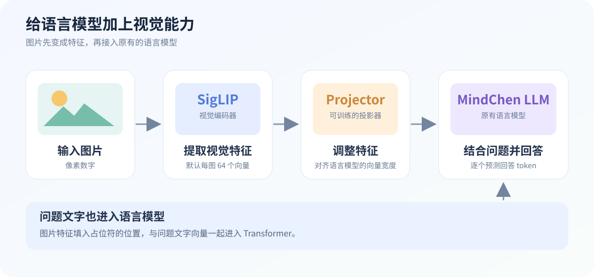
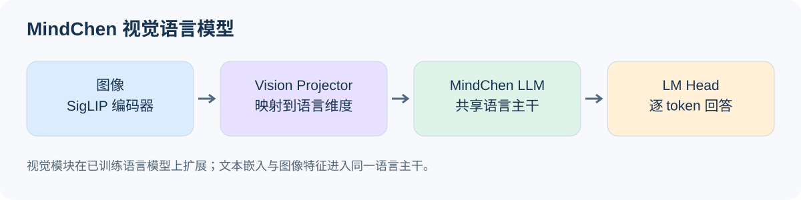
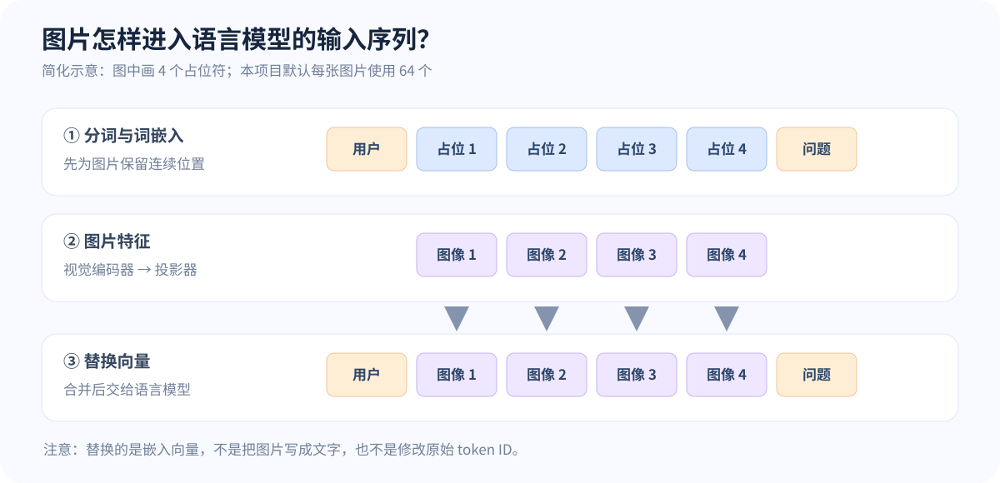
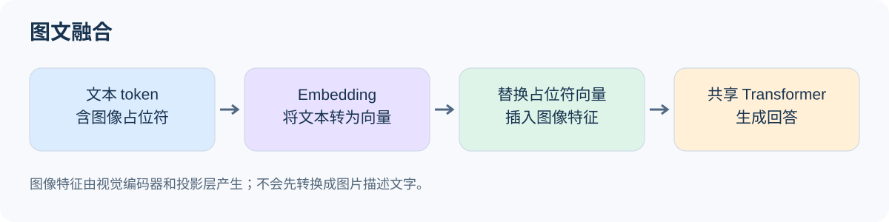
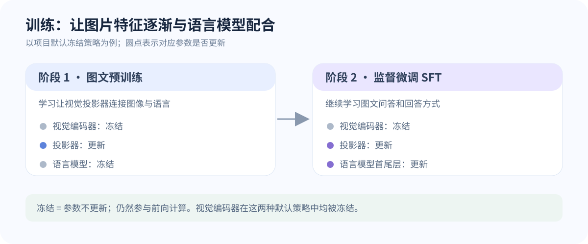

# MindChen-V 新手技术文档


如果你最想知道“怎样让语言模型看图”，建议先读第 1 节的图，再读第 5 节的数据示例和第 6 节的代码讲解。图里的“图片特征”是一组数字，并不是模型先把图片翻译成一句文字。

## 1. 它做什么

模型接受一张图片和一段文字，逐个 token 预测回答。它由三个主要部分组成：SigLIP 视觉编码器把图片变成向量；投影器把视觉向量变换到语言模型使用的空间；MindChen 语言模型把图片向量与文字一起处理，生成回答。



**先抓住一个核心变化：**原来的语言模型接收文字向量；加入视觉模块以后，图片先被视觉编码器和投影器处理，再以向量的形式放入同一条输入序列。语言模型仍按原来的方式处理序列并预测回答。上图是对当前代码的简化示意。

### 1.1 原来的语言模型是怎样工作的？

假设你输入“今天天气”。Tokenizer（分词器）先把文字拆成 token 并转成编号；词嵌入层把编号转换成数字向量；Transformer 处理这些向量，预测下一个 token。它接收的是向量序列，因此原始图片像素不能直接当作普通文字编号送进去。

### 1.2 加上什么，才能处理图片？

可以想象给语言模型接上一双“眼睛”和一个“适配器”：

1. **眼睛：视觉编码器。** SigLIP 接收经过预处理的图片，输出描述图片的特征向量。
2. **适配器：投影器。** 将视觉特征变换成语言模型使用的隐藏维度，并通过训练学习合适的表示。
3. **接入口：图片占位符。** 在对话里预留图片位置；模型运行时用处理后的图片向量替换这些位置上的词向量。

“眼睛”和“适配器”只是帮助理解的比喻。图像特征是模型学到的数字表示，不保证某个向量恰好对应人能命名的某个物体；维度对上也不等于模型已经理解图片，还需要图文数据训练。

### 1.3 整体架构图



*图：项目自带的 MindChen-V Dense 架构图，按当前共享语言主干实现绘制。* 图从下向上看：左下角 `Vision Encoder` 和 `Vision Projector` 是接入图片的新增部分；中间的 `Tokenizer`、`Input Embedding`、`Transformer Layer` 是语言模型路径。红色箭头表示图片特征接入语言模型。右侧展开的是 Transformer 内部的注意力和前馈网络；初学时先认识左半部分即可。

```text
图片 → 视觉预处理 → SigLIP → 64 个图片特征 → 投影器 ─┐
文字 → 聊天模板 → 分词 → token ID → 词嵌入 ──────────┤
                       用图片特征替换图片占位符的向量 ─┘
                                  ↓
                     Transformer → 词表概率 → 回答
```

token 是分词后的基本单位，可能是一个汉字、词的一部分或特殊标记；向量是由一组数字组成的特征。模型参数是训练时调整的数字；权重文件保存这些参数。

可以先把整个模型想成一个合作小组：

```text
  用户：这张图片里有什么？
           │
           ▼
  [视觉编码器] 负责看图，把图片变成一组数字特征
           │
           ▼
  [投影器]     负责调整这些数字，让语言模型能够接收
           │
           ▼
  [语言模型]   结合图片特征和问题，逐个 token 生成回答
           │
           ▼
  回答：图片里有一只狗。   （仅作说明，实际输出由训练效果决定）
```

这里的“看图”和“回答”是方便理解的说法：计算机实际处理的是数字。你可以把投影器理解为连接两个部件的适配器；它需要通过训练学会怎样调整图片特征。

## 2. 项目地图

| 文件 | 作用 |
|---|---|
| `model/model_vlm.py` | 视觉编码器、投影器、图文融合、损失和生成接口。 |
| `model/model_mindchen.py` | 语言模型的配置、注意力、位置编码、Transformer、MoE 和生成。 |
| `dataset/lm_dataset.py` | 从 Parquet 读取对话与图片，构造输入和标签。 |
| `trainer/train_pretrain_vlm.py` | 图文预训练入口，默认冻结语言模型，只训练投影器。 |
| `trainer/train_sft_vlm.py` | 图文监督微调入口，默认解冻语言模型首尾层和投影器。 |
| `trainer/trainer_utils.py` | 初始化、冻结、学习率、保存、续训与数据批处理。 |
| `eval_vlm.py` | 加载模型，对图片目录逐张生成描述。 |
| `scripts/convert_vlm.py` | 原生 PyTorch 权重和 Transformers 格式之间的转换。 |
| `scripts/web_demo_vlm.py` | Gradio 网页对话，加载转换后的 Transformers 模型。 |

## 3. 环境和文件

建议创建独立的 Python 3.11 环境，按设备安装 PyTorch，然后安装 `requirements-core.txt`。扩展依赖见 `requirements.txt`。

需要下列资源：

```text
model/tokenizer.json、model/tokenizer_config.json
model/siglip2-base-p32-256-ve/   # 配置、预处理配置、模型权重
out/llm_768.pth                  # 与 768 维、8 层 dense 配置匹配的语言模型
dataset/pretrain_i2t.parquet
dataset/sft_i2t.parquet
```

检查时本机的预训练数据有 1,274,698 条，SFT 数据有 2,904,511 条。完整训练的时间取决于显卡、批次、序列长度和数据读取速度。运行正式训练前可用 `nvidia-smi` 检查显存和负载。训练会向 `out/` 和 `checkpoints/` 写入同名文件，重新运行可能覆盖它们。

## 4. 实际操作

先看清楚训练文件是怎样接力的：

```text
语言模型基座                     视觉编码器
out/llm_768.pth                  model/siglip2-base-p32-256-ve/
        │                                      │
        └──────────────┬───────────────────────┘
                       ▼
预训练数据 ──────► [第一阶段：预训练]
                       │
                       ▼
              out/pretrain_vlm_768.pth
                       │
SFT 数据 ──────────────┼────► [第二阶段：监督微调]
                       │                 │
                       └─────────────────┘
                                         ▼
                                out/sft_vlm_768.pth
                                         │
                                         ▼
                                  eval_vlm.py 推理
```

训练保存的模型权重不包含视觉编码器，所以评估时仍需要保留视觉编码器目录。每阶段还会保存续训检查点，里面包含优化器等训练状态。

先在 PowerShell 中执行：

```powershell
cd ./
conda activate mindchen
python -c "import torch; print(torch.__version__, torch.cuda.is_available())"
```

第一阶段：预训练图文投影层。这里 `epochs 1` 为示例，项目脚本默认是 2；`batch_size 1` 便于显存紧张时起步。按日志和显存情况调整。

```powershell
python -X utf8 trainer/train_pretrain_vlm.py --epochs 1 --batch_size 1 --num_workers 0 --log_interval 100
```

输出 `out/pretrain_vlm_768.pth`，以及 `checkpoints/pretrain_vlm_768_resume.pth`。第二阶段读取第一阶段输出：

```powershell
python -X utf8 trainer/train_sft_vlm.py --epochs 1 --batch_size 1 --num_workers 0 --log_interval 100
```

输出 `out/sft_vlm_768.pth`。想使用其他文件名前缀，可用 `--save_weight 名称`；SFT 的 `--from_weight 名称` 从 `out/名称_768.pth` 读取。`--save_dir` 控制训练输出目录，**不改变初始权重的读取目录** `out/`。`--use_moe 1` 需要架构匹配的 `_moe` 初始权重，本机现有的 `out/llm_768.pth` 是 dense 权重，不能直接当成 MoE 基座。

中断后续训时，保持数据、批次大小、模型参数、冻结策略和输出前缀一致，并加 `--from_resume 1`；例如：

```powershell
python -X utf8 trainer/train_pretrain_vlm.py --epochs 1 --batch_size 1 --num_workers 0 --from_resume 1
```

续训检查点还包含优化器、轮次、步数和缩放器；普通 `out/*.pth` 只用于加载模型参数。续训以最近一次保存为准，保存间隔通过 `--save_interval` 设置。完成一轮后再续训相同总轮数不会额外训练；`--epochs` 是目标总轮数，不是额外增加的轮数。

完成 SFT 后运行：

```powershell
python -X utf8 eval_vlm.py --weight sft_vlm --max_new_tokens 128
```

默认读取 `dataset/eval_images`，`--image_dir` 可指定其他目录。`--weight pretrain_vlm` 可查看预训练阶段输出。要得到可信效果，需要充分训练并用独立的验证样本检查，不要把训练损失或几句生成结果当成模型质量的完整评价。

## 5. 数据如何变成训练样本

### 5.1 先认识一条数据

想象数据集里有这样一行：

```text
┌─────────────────────────────────────────────────┐
│ 图片：一张小狗照片（存放在 image_bytes）          │
│ 用户：<image> 这是什么？                         │
│ 助手：这是一只小狗。                             │
└─────────────────────────────────────────────────┘
```

这只是一条示意数据。图片在文件中是字节，程序读取后才变成可处理的图片；`<image>` 告诉程序图片应该放在对话的哪个位置。

Parquet 每行包含 `conversations`（JSON 对话）和 `image_bytes`（图片字节）。对话中的 `<image>` 会被展开成连续 64 个 `<|image_pad|>`；tokenizer 的聊天模板加上角色与结束标记，再变成 token ID。长度超过 `max_seq_len` 会截断，不足则补齐。请确保截断后保留完整的图片占位符和 assistant 回答，否则会影响图文对齐或产生没有有效标签的样本。

`generate_labels` 把非 assistant 回答位置设为 `-100`；交叉熵忽略这些位置。训练时通过右移标签，让前面的上下文预测下一个回答 token。图像经 processor 缩放、归一化后，批次由 `vlm_collate_fn` 堆叠；同一批次需要有相同数量的图片。

### 5.2 图片标记与监督标签



这张图的三行分别对应：先给图片留位置、再计算图片特征、最后把图片特征放进去。请注意，这里画四个位置只是为了看清过程；当前默认配置为 64 个。

```text
原始对话：  用户：[图片] 这是什么？     助手：这是一只小狗。
                       │
                       ▼ 展开图片标记，并加入角色标记、分词
输入：      [用户] [图][图]…[图] [问题] [助手] [回答 token……] [结束]
                   └── 共 64 个 ─┘
标签：      -100   -100 … -100   -100   -100   [回答 token……] [结束]
             └──────────── 不计入损失 ──────────┘ └── 计入损失 ──┘
```

图中的 `[图]` 是对 `<|image_pad|>` 的简写。`-100` 可以理解为“这一格不打分”，它不是模型生成的文字。程序只对助手回答及其结束标记计算损失，但问题和图片仍作为上下文参与计算。实际每段文字分成多少 token 由 tokenizer 决定，图中格数只是示意。

再看“预测下一个 token”是什么意思：

```text
已经看到：图片 + 问题 +「这」      希望预测：「是」
已经看到：图片 + 问题 +「这是」    希望预测：后面的 token
```

这里把汉字当成 token 只是为了容易看懂；实际分词不一定按单个汉字切分。模型预测与参考答案相差多少，由损失函数计算；随后反向传播根据损失调整允许训练的参数。

## 6. 重点：model/model_vlm.py 逐段讲解

下面这张是模型的输入融合图。**先看上半部分**：图片经过 `Vision Encoder` 和 `Vision Projector` 得到图片向量；**再看下半部分**：问题和图片占位符经过 tokenizer 与 embedding 得到文字向量；最后 `Replace` 把图片向量放进占位符位置，送入右侧的语言模型。



*图：项目自带的图文输入图，按当前共享语言主干实现绘制。图中 M 表示图片特征位置数；当前默认配置中 M 为 64。*

1. **`VLMConfig`** 继承语言模型配置。`image_special_token` 是图片占位符，`image_ids` 是其 token ID，`image_token_len=64` 是每张图片预留的位置数，`image_hidden_size=768` 是视觉特征维度。占位符 ID 必须与 tokenizer 对应。
2. **`MMVisionProjector`** 是 LayerNorm → Linear → GELU → Linear。它逐个处理图片块的向量，把视觉维度映射到语言隐藏维度。虽然构造函数接收 `source_tokens` 和 `target_tokens`，当前实现不改变 token 数量，因此视觉编码器输出数应与占位符数量一致。
3. **`MindChenVLM.__init__`** 先构造语言模型，再加载 SigLIP 和 processor，最后创建投影器。`get_vision_model` 冻结视觉编码器参数；训练初始化时若视觉模型不存在会报错。
4. **`image2tensor` / `get_image_embeddings`** 前者将 PIL 图片交给视觉 processor；后者在 `torch.no_grad()` 中运行视觉编码器，取 `last_hidden_state`。默认每图得到 64 个视觉 token。`no_grad` 降低显存，投影器仍参与反向传播。
5. **`count_vision_proj`** 首先查找每条序列里连续的图片占位符，再按出现顺序把对应图像的投影向量放到这些位置。文字和图片因此处于相同的隐藏维度，后续 Transformer 不需要额外的跨模态注意力层。图片数、顺序和占位符组必须对应。
6. **`forward`** 把输入 ID 变成词嵌入；首次处理图片时调用视觉编码器和投影器，再替换占位符向量。接着取 RoPE 位置编码、逐层执行语言模型、归一化、通过 `lm_head` 得到词表 logits。提供标签时计算右移的交叉熵，返回 loss、logits、KV 缓存等。MoE 时额外有辅助损失。
7. **`generate`** 使用父类的自回归生成；每一步基于已生成上下文预测下一个 token。使用 KV 缓存时图片只在首轮编码，后续复用上下文缓存。多条候选回复时复制图片输入。

形状举例：单图批次 `B=1`，图像编码后大致为 `[1, 64, 768]`，投影后仍为 `[1, 64, 768]`，替换到文本隐藏状态 `[1, 序列长度, 768]` 中。具体维度随配置变化。

### 6.1 跟着一次 `forward` 走

第一次阅读源码时，可以从 `forward` 开始，沿着这张图找对应语句：

```text
input_ids：对话中的 token 编号        pixel_values：预处理后的图片
            │                                    │
            ▼                                    ▼
   embed_tokens：编号变向量             vision_encoder：图片变特征
            │                                    │
            │                                    ▼
            │                            vision_proj：转换维度
            │                                    │
            └─────────────┬──────────────────────┘
                          ▼
          count_vision_proj：在占位符位置放入图片向量
                          │
                          ▼
          Transformer 各层：结合前面的图文信息
                          │
                          ▼
                 norm + lm_head：计算词表分数
                          │
              ┌───────────┴───────────┐
              ▼                       ▼
       有 labels：计算损失       生成时：选择下一个 token
```

`input_ids` 是整数编号，`hidden_states` 是模型内部的向量，`logits` 是词表中各候选 token 的分数。`forward` 的输入和输出不只是文字，它们通常是张量：可以把张量先理解成有形状的数字表。

如果对照代码阅读，按照下面的顺序找关键语句即可：

| 步骤 | 对应代码 | 用一句话理解 |
|---|---|---|
| 组装模型 | `MindChenVLM.__init__` 中的 `super().__init__(self.config)` | 先建立原有语言模型。 |
| 添加视觉部分 | `get_vision_model(...)` 和 `MMVisionProjector(...)` | 加载视觉编码器，并创建投影器。 |
| 文字变向量 | `self.model.embed_tokens(input_ids)` | 将 token 编号变成语言模型能计算的向量。 |
| 图片变向量 | `get_image_embeddings(...)` | 使用冻结的视觉编码器提取图片特征。 |
| 转换图片特征 | `self.vision_proj(...)` | 把图片特征映射到语言模型的隐藏维度。 |
| 接入图片 | `self.count_vision_proj(...)` | 找到图片占位符，用图片向量替换相应位置。 |
| 语言模型计算 | `for ... in self.model.layers` | 让 Transformer 处理融合后的序列。 |
| 预测和训练 | `self.lm_head(...)`、`F.cross_entropy(...)` | 计算词表分数；有标签时计算预测误差。 |

下面是删去形状处理和缓存细节后的**理解版伪代码**，帮助你看清关键连接点；它不是可以直接替换原函数的完整代码：

```python
# 文字和图片先分别转换为向量
文字向量 = 语言模型.词嵌入(input_ids)
图片特征 = 视觉编码器(pixel_values)
图片向量 = 投影器(图片特征)

# 把图片向量放到文字序列里提前留好的位置
图文向量 = 替换占位符位置(文字向量, 图片向量)

# 复用语言模型，继续预测回答
隐藏状态 = 语言模型.Transformer(图文向量)
词表分数 = 语言模型.输出层(隐藏状态)
```

实际代码会处理批次、多张图片、注意力掩码和 KV 缓存；训练代码还会根据 `freeze_llm` 决定哪些参数更新。

### 6.2 为什么要替换占位符？

下图只画出 4 个图片位置。项目默认一张图片有 64 个位置：

```text
替换前的文字向量： [用户] [占位1] [占位2] [占位3] [占位4] [问题] [助手]
                             ▲       ▲       ▲       ▲
                             │       │       │       │
投影后的图片向量：          [图1]   [图2]   [图3]   [图4]
                             │       │       │       │
                             ▼       ▼       ▼       ▼
替换后的输入：     [用户]  [图1]   [图2]   [图3]   [图4]  [问题] [助手]
```

这里替换的是**词嵌入后的向量**，不是把图片文字插入原始字符串。`count_vision_proj` 用 token ID 找位置，再把对应位置的向量换成视觉特征。多张图片时，代码按占位符组和图片输入的顺序对应，因此两者的数量、顺序必须一致。

### 6.3 形状中的数字是什么意思？

```text
图片特征：[ 1,     64,       768 ]
           │       │          │
           │       │          └─ 每个特征向量有 768 个数字
           │       └──────────── 一张图片提供 64 个特征位置
           └──────────────────── 这个批次有 1 条样本

文字向量：[ 1, 序列长度, 768 ]
           │       │       │
           │       │       └──── 每个位置的语言模型向量宽度
           │       └──────────── 文字、角色标记、图片占位符等的位置总数
           └──────────────────── 批次大小
```

两路向量最后一维需要对得上，才能把图片向量放入文字序列。默认配置里两边恰好都是 768，但投影器即使输入和输出维度相同，仍会学习怎样变换视觉特征。`MMVisionProjector` 当前不负责把 64 个特征压缩成更少的 token。

### 6.4 生成时为什么要用缓存？

```text
第 1 次：看图片 + 问题             → 生成第 1 个 token，并保存缓存
第 2 次：读取缓存 + 第 1 个 token  → 生成第 2 个 token
第 3 次：读取缓存 + 第 2 个 token  → 生成第 3 个 token
                                  ……直到结束或达到长度上限
```

KV 缓存保存了注意力计算中可复用的键和值，减少重复处理已经看过的上下文。在本实现使用缓存的正常生成路径中，图片在首次前向时处理；后续步骤使用已有缓存。缓存不等于保存模型权重，关闭程序后它通常就消失了。

### 6.5 两个训练阶段到底训练哪里？



上图画的是当前两个脚本的默认策略。它们用已有的语言模型和视觉编码器作为起点，而投影器需要通过图文样本学习如何连接二者。

```text
部件                   默认预训练 freeze_llm=2     默认 SFT freeze_llm=1
视觉编码器 SigLIP          冻结                         冻结
视觉投影器                 更新                         更新
语言模型中间层             冻结                         冻结
语言模型首层和末层         冻结                         更新
```

“冻结”表示参数不随优化器更新，不表示这部分停止参与前向计算。预训练先帮助投影器把图片信息送进语言模型；SFT 再用问答样本调整投影器及语言模型首尾层。两阶段使用的数据和学习率也不同，效果仍取决于数据质量和训练过程。

## 7. 训练参数和常见问题

先用一个小图理解批次和梯度累积。假设共有 8 条样本：

```text
batch_size=2，accumulation_steps=2

第 1 次前向/反向：[样本1 样本2] ─┐
                                  ├─ 累积梯度 → 更新一次参数
第 2 次前向/反向：[样本3 样本4] ─┘

第 3 次前向/反向：[样本5 样本6] ─┐
                                  ├─ 累积梯度 → 再更新一次参数
第 4 次前向/反向：[样本7 样本8] ─┘
```

每次同时放入显卡的是 2 条，示例中每次参数更新参考了 4 条样本。实际训练中，一轮末尾的剩余批次和多卡情况需要另行考虑。

`batch_size` 是一次送入的样本数；`accumulation_steps` 是累计多少次梯度再更新，常用于节省显存。`learning_rate` 控制更新幅度；`max_seq_len` 决定序列上限和显存开销；`num_workers 0` 适合 Windows 排查加载问题。`freeze_llm=2` 只训练投影器，`1` 解冻首尾 Transformer 层，`0` 解冻语言模型；视觉编码器始终冻结。`dtype` 默认 bfloat16，CPU 不使用 CUDA 混合精度。

显存不足时减小 batch 和序列长度，但要保留图文和回答。若找不到视觉模型，检查目录下权重与配置是否完整；若找不到 `.pth`，检查前缀、hidden_size 和 MoE 后缀。若出现全 NaN 损失，检查截断后是否还有 assistant 标签。Windows 原生多卡 DDP 的 NCCL 支持受限；当前已验证的是单卡流程，多卡需在合适的 Linux/CUDA 环境另外验证。

## 8. 本次验证记录与边界

使用真实数据集各取前 2 行、单卡、batch 1、序列长度 256：预训练 2 步 loss 约 3.11、3.34，保存成功；SFT 2 步 loss 约 2.39、3.33，保存成功；预训练从检查点恢复到下一轮并再完成 2 步。评估用 SFT 小样本权重生成了 4 个 token，验证了加载与生成。测试文件分别位于 `smoke_data/`、`out/smoke_*` 和 `checkpoints/smoke_*`，避免覆盖正式权重。这不是完整数据训练，也不证明模型已具备可靠识图能力。完整训练、多卡、MoE、格式转换与网页尚未验证。
